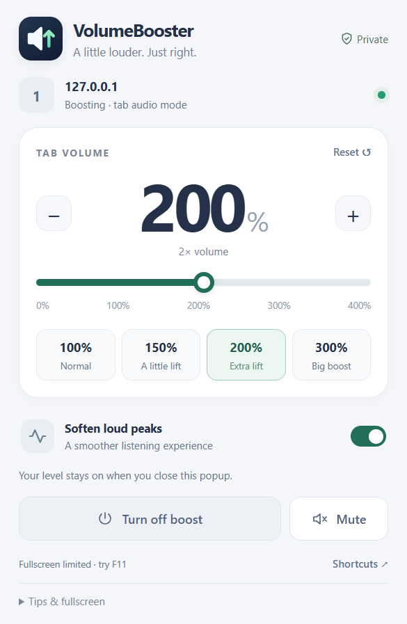

<p align="center"></p>

<h1 align="center">VolumeBooster</h1>

<p align="center">A little louder. Just right.</p>

<p align="center"><a href="https://github.com/saeidshirazi/VolumeBooster/actions/workflows/checks.yml"></a> · Chrome 116+ · Manifest V3 · Local audio processing</p>

<p align="center"></p>

A Chrome extension for quieter videos, music, and calls. Choose a level and keep listening. Boost a tab from **0–400%**, use quick presets or +/−, mute instantly, and soften sudden loud peaks. All audio processing stays on your computer. No accounts, recording, uploads, analytics, remote code, or runtime dependencies.

- **One click to boost.** Pick a preset or move the slider; it starts automatically.
- **Easy adjustments.** +/− changes the level by 25 points. Reset returns to 100%.
- **Per-tab controls.** Each tab keeps its own volume and mute state.
- **Fullscreen support.** Compatible players use direct audio processing. The popup identifies fallback mode and its fullscreen limitations.
- **Small permission footprint.** Access only the tab you explicitly enable; no permission to read all websites.

## Install

1. Download this repository using **Code → Download ZIP** and extract it, or clone it.
2. Open `chrome://extensions` in Chrome.
3. Enable **Developer mode**.
4. Click **Load unpacked** and select the repository's **extension** folder.
5. Pin VolumeBooster from Chrome's Extensions menu.
6. Play audio on a website, open VolumeBooster, and choose a preset or move the slider.

Each tab is independent. **Turn on boost** starts at 100%; choosing a preset or slider level starts directly at that level. Closing the popup keeps boosting active. **Turn off boost** restores the original audio path/level. Start gently and lower the level if you hear distortion.

This is a development extension, not a Chrome Web Store listing. GitHub Actions builds an installable ZIP under the latest successful run's **Artifacts**. Extract it before choosing Load unpacked.

## Fullscreen and the two audio modes

**Direct mode** processes compatible HTML audio/video players through Web Audio, keeping native fullscreen available. Tested with public YouTube playback and native video fullscreen. Direct mode checks media origin, explicit CORS configuration, and DRM status before attaching a source; it does not change player URLs or cross-origin settings. It observes newly added media elements for single-page navigation. After a full page reload or navigation, open the popup and enable it again.

**Capture mode** handles other sources, including players without an accessible compatible media element. It processes the tab's mixed audio in an offscreen document. Chrome can restrict native fullscreen while a tab is captured; the popup clearly identifies capture mode. Some sites may require browser fullscreen (F11) instead. Capture mode persists across ordinary reloads and navigation within the tab.

Enable the extension before entering fullscreen. Use these shortcuts once a tab is enabled:

| Shortcut | Action |
| --- | --- |
| Alt + Shift + V | Open VolumeBooster |
| Alt + Shift + Up | Increase by 10 percentage points |
| Alt + Shift + Down | Decrease by 10 percentage points |
| Alt + Shift + M | Mute/unmute |

Customize conflicting assignments at `chrome://extensions/shortcuts`. Operating systems and browsers may reserve keys. Shortcut command handling is covered by unit tests; physical shortcut delivery still needs a manual check on your setup.

## Audio and compatibility

Both engines use a gain node with a 25 ms smoothing time constant, followed by an optional peak compressor. Peak softening is enabled initially. It changes dynamics and can slightly affect levels even at 100%; turn it off for an uncompressed unity-gain path. It is not a hard limiter and cannot guarantee distortion-free audio or repair an already clipped recording.

Browser internal pages cannot be boosted. Protected media, browser policies, existing player audio processing, or another capture extension can limit compatibility. Site players and your device must be unmuted and have nonzero volume. Cross-origin embedded players and shadow-DOM players currently use capture fallback when no compatible top-level element is available. Dynamic changes from a safe media source to a non-CORS cross-origin source on the same attached element may require a page reload.

In direct mode, Stop resets the graph to unity gain with compression bypassed. Web Audio's media-source attachment is one-time, so the passthrough AudioContext remains alive until the page unloads. Capture mode Stop releases the stream and AudioContext completely. Closing a tab releases its resources.

YouTube audio boosting and native video fullscreen passed initial live validation. Fullscreen automation is focus-sensitive: the redesign's live retest boosted YouTube audio successfully, but fullscreen was denied before and after enabling the extension. See [TESTING.md](TESTING.md) for the exact scope. Spotify account playback, DRM behavior, long listening sessions, and Edge/Brave have not been validated. Firefox and Safari need separate implementations. This release targets Chrome 116+, tested in Chromium/Chrome for Testing 158.

## Permissions and privacy

- `activeTab`: temporary access to the tab you explicitly enable.
- `scripting`: attach the direct audio engine to that selected tab.
- `tabCapture`: fallback processing for the selected tab's mixed audio.
- `offscreen`: keep fallback audio playing after the popup closes.

There are no broad host permissions, background site scanning, storage permissions, or external network requests from the extension. Chrome shows its own capture indicator in capture mode.

## Development

```
npm install
npx playwright install chromium
npm test
npm run test:browser
npm run package
```

To include the optional public YouTube check:

```
npm run test:browser -- --live-sites
```

Tests use an isolated browser profile, generated quiet audio, real extension capture, the native toolbar popup, audio signal measurements, fullscreen transitions, reloads, and worker lifecycle checks. Runtime files are not modified by tests. Audio probes are installed only into the isolated test process. Live-site checks report external failures separately in `test-results/browser.json`; inspect that report even if the deterministic suite exits successfully.

The package command produces `dist/VolumeBooster-Chrome.zip` with only extension runtime files. Extract the ZIP before using Load unpacked. Chrome Web Store publication is a separate step. To regenerate the PNG icons from the editable SVG logo, run `npm run icons` after installing the test browser.

See [TESTING.md](TESTING.md) for validation scope. Architecture follows Chrome's [tab capture](https://developer.chrome.com/docs/extensions/reference/api/tabCapture), [offscreen processing](https://developer.chrome.com/docs/extensions/how-to/web-platform/screen-capture), and [on-demand script injection](https://developer.chrome.com/docs/extensions/reference/api/scripting) APIs.
