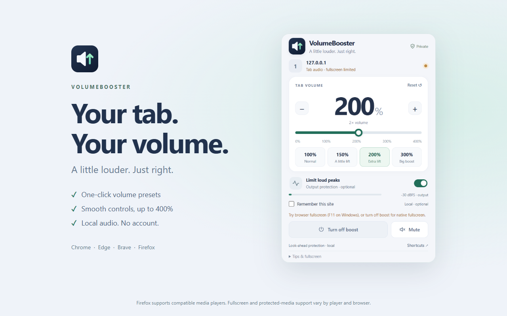

<p align="center"></p>
<h1 align="center">VolumeBooster</h1>
<p align="center">A little louder. Just right.</p>
<p align="center"><a href="https://github.com/saeidshirazi/VolumeBooster/actions/workflows/checks.yml"></a> · Chrome · Edge · Brave · Firefox · MIT</p>
<p align="center"></p>

Smooth volume control for quieter videos, music, and calls. Choose a preset or move the slider to start boosting the tab you're on. Each tab has its own level. **No accounts, recordings, uploads, analytics, ads, or runtime dependencies.**

- Volume from **0–400%**, with one-click presets, +/−, and Reset.
- Mute without losing your chosen volume.
- Optional 5 ms look-ahead sample limiter, with a clearly identified peak-ceiling fallback.
- Live output meter, recovery guidance and Retry audio.
- Opt-in remembered site levels, stored locally and removable anytime.
- Native fullscreen on compatible media players.
- Keyboard shortcuts and the browser's own shortcut settings.
- Four native browser packages, open source under the [MIT license](LICENSE).

## Download and install

[All release assets](https://github.com/saeidshirazi/VolumeBooster/releases/tag/v0.4.2) include the browser packages, source, design assets, and SHA-256 checksums.

| Browser | Download | Install |
| --- | --- | --- |
| Chrome 116+ | [Chrome ZIP](https://github.com/saeidshirazi/VolumeBooster/releases/download/v0.4.2/volumebooster-0.4.2-chrome.zip) | Extract → `chrome://extensions` → Developer mode → Load unpacked |
| Microsoft Edge (Chromium 116+) | [Edge ZIP](https://github.com/saeidshirazi/VolumeBooster/releases/download/v0.4.2/volumebooster-0.4.2-edge.zip) | Extract → `edge://extensions` → Developer mode → Load unpacked |
| Brave (Chromium 116+) | [Brave ZIP](https://github.com/saeidshirazi/VolumeBooster/releases/download/v0.4.2/volumebooster-0.4.2-brave.zip) | Extract → `brave://extensions` → Developer mode → Load unpacked |
| Firefox 142+ | [Unsigned Firefox XPI](https://github.com/saeidshirazi/VolumeBooster/releases/download/v0.4.2/volumebooster-0.4.2-firefox-unsigned.xpi) | For testing: `about:debugging#/runtime/this-firefox` → Load Temporary Add-on |

Select the extracted folder containing `manifest.json` for Chromium installations. Firefox also accepts the extracted `dist-firefox/manifest.json` during development. **Permanent Firefox installation requires Mozilla signing**; a temporary add-on disappears when Firefox closes. Do not disable signature checks.

Pin VolumeBooster, play audio, open its popup, and choose 150% or 200%. Increase gradually. Closing the popup keeps processing active; **Turn off boost** restores original playback. Optionally enable Remember this site to restore compatible players after reload. [Full browser installation guide](CROSS-BROWSER.md).

## Fullscreen and compatibility

Compatible HTML audio/video players use **direct processing**, preserving native fullscreen. Chrome, Edge, and Brave also have **tab audio capture** as a fallback for other sources. Those browsers may restrict fullscreen during capture; the popup identifies the mode and suggests F11. **Firefox has no Chromium tab-capture API**: incompatible protected/non-CORS players get a clear error, and their original playback remains intact.

This cannot boost every site or bypass DRM, cross-origin policies, muted devices, browser-internal pages, or another audio extension's exclusive attachment. Cross-origin embeds and shadow-DOM-only players may need Chromium capture. Safari and mobile are not part of this four-desktop-browser release. See the [browser feature matrix](CROSS-BROWSER.md).

Both engines smooth gain changes with a 25 ms time constant. Worklets use a shared, stereo-linked 5 ms look-ahead sample limiter; unsupported environments use a soft/sample ceiling that can alter dynamics and stereo balance. The popup identifies the fallback. This is not an intersample or physical-loudness guarantee. [Audio processing details](docs/AUDIO-PROCESSING.md).

In direct mode, Stop restores a unity-gain path with peak protection bypassed. The browser's one-time media attachment remains alive until the page unloads so the site stays audible. Capture-mode Stop releases its stream and AudioContext completely.

## Keyboard controls

| Shortcut | Action |
| --- | --- |
| Alt + Shift + V | Open VolumeBooster |
| Alt + Shift + Up / Down | Adjust this enabled tab by 10 percentage points |
| Alt + Shift + M | Mute/unmute this enabled tab |

Use **Shortcuts** in the popup to change conflicts in your browser's native settings. Operating systems may reserve keys. Physical shortcut delivery depends on your setup; the handlers and settings routes are tested.

## Privacy and permissions

All processing is local. No microphone/camera capture, saved audio, external service or history collection. Both engines use `activeTab`, `scripting` and `storage`; Chromium additionally uses `tabCapture` and `offscreen`. Remember this site requests optional access only to the selected host and saves its exact origin, volume and protection preference. Automatic restoration never starts capture. Firefox declares no data collection. [Privacy policy](PRIVACY.md).

## Build and test

Node 22+:

```sh
npm ci
npm run build:all
npm test
npx playwright install chromium firefox
node tests/browser.mjs --browser=chrome
node tests/browser.mjs --browser=edge
node tests/browser.mjs --browser=brave
npm run test:firefox
npm run lint:firefox
```

Edge and Brave tests use their installed native browsers; Firefox uses Selenium with a temporary native add-on. Fresh profiles and generated audio keep personal sessions untouched. Test-only Web Audio probes measure real signal gain and mute behavior. `--headless` runs Chromium suites in CI mode with audio unmuted; layout checks verify a 390 px body and controls within desktop popup bounds. `--site-memory --limiter --compatibility --endurance` verifies saved levels, real offline DSP, Retry and a two-minute playback regression. Memory fixtures pre-grant localhost in a test-only manifest; baseline tests use the unmodified build. `--live-sites` optionally adds public YouTube and Twitch playback checks; live fullscreen is focus/network-sensitive.

```sh
npm run package
node scripts/verify-release.mjs
# For a new public release after final verification:
npm run package:public
npm run verify:release
```

Build folders: `dist`, `dist-edge`, `dist-brave`, `dist-firefox`. Archives: `release/local/v0.4.2` or `release/public/v0.4.2`. Verified public archives are sealed against replacement. The runtime is plain JavaScript; ZIP/XPI files have `manifest.json` at the root. [Validation results](TESTING.md) · [Contributing](CONTRIBUTING.md).

## Community

[Report a bug](https://github.com/saeidshirazi/VolumeBooster/issues) · [Security](SECURITY.md) · [Community conduct](CODE_OF_CONDUCT.md) · [Changelog](CHANGELOG.md).
